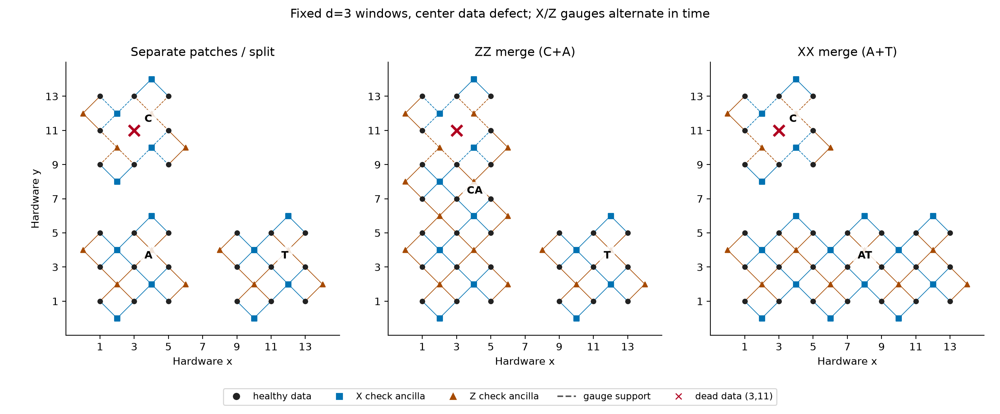
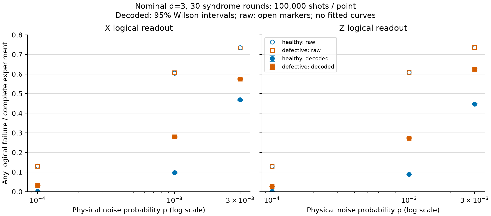

# 固定 d=3 窗口、中心数据缺陷的完整逻辑 CNOT demo

本目录实现并运行了三个 surface-code patches 的 lattice-surgery CNOT。控制 C 的中心数据比特 (3,11) 永久失效；缺陷前各 patch 为 d=3，窗口不扩大。主线路包含完整制备、ZZ merge/split、XX merge/split、辅助读出和控制/目标读出，使用物理局域门，不使用 MPP。

**实测结果：** 缺陷 C 的静态 dressed CSS 距离为 (d_X,d_Z)=(2,2)；完整缺陷 CNOT 在 X、Z 两种读出下的未分解 DEM 故障距离均为 2。同几何、同时序无缺陷对照均为 3。共完成 12 组 × 100,000 shots。距离 2 无法保证纠正任意单故障；本例用于研究距离损失后的操作与解码性能。

## 直接查看

- 主线路：[缺陷 X 读出](results/defective/cnot_X.stim)、[缺陷 Z 读出](results/defective/cnot_Z.stim)。同名 `.noisy.stim` 使用 p=0.001。
- 同几何对照：[healthy](results/healthy/)。独立 TQEC k=1 参考：[tqec_reference](results/tqec_reference/)。
- 数据：[statistics.csv](results/statistics.csv)、[summary.json](results/summary.json)、[配置及版本](results/config.json)。
- 校验、gauges、逻辑代表和静态距离见各案例 `patches.json`。线路阶段、物理操作、测量绝对编号、frame、四个带符号 flow 及距离 witness 见 `cnot_X.metadata.json` / `cnot_Z.metadata.json`。



数据比特为圆点，X/Z 校验辅助比特分别为方形/三角形，虚线表示 gauge support。红叉表示永久禁用的位置。图中展示两种 gauge 的空间支持，实际按 X、Z 分轮测量。

## 运行

### Jupyter Notebook 分步教程

[defective_cnot_d3_walkthrough.ipynb](defective_cnot_d3_walkthrough.ipynb) 包含 46 个单元（22 个代码单元），逐步调用已有函数完成源码核验、patch/gauges、完整 CNOT 及五阶段检查、frame/flows、真值表/Bell、噪声/DEM、距离、MWPM 采样、导出、图表和独立 TQEC 参考。

已用新的 Conda 环境从干净内核执行全部单元，无错误，默认每组 100,000 shots，共 1,200,000 shots；Notebook 保留运行输出。验证记录见 [notebook_execution_validation.json](notebook_execution_validation.json)。本次 Conda 运行产物位于 [notebook_runs/20261013T090427_654865Z/](notebook_runs/20261013T090427_654865Z/)，12 组 CSV 记录与原实验完全一致。每次重跑使用新的时间戳目录。第二节 `SHOTS` 是采样规模入口；先减小它可快速试跑，p 列表保持三个不同正概率点。

从工作区根目录启动：

```powershell
& './实验代码/defective_cnot_d3/open_notebook.ps1'
# 新环境在完成 setup_env.ps1 后，首次启动可安装锁定的 Notebook 依赖：
& './实验代码/defective_cnot_d3/open_notebook.ps1' -InstallDependencies
```

脚本在前台启动本地 JupyterLab；用浏览器打开终端给出的本地地址，选择 `Conda defective-cnot-d3 (Python 3.12)` 内核，执行 Restart Kernel and Run All。Ctrl+C 停止服务器。也可在 VS Code 直接打开 `.ipynb` 并选择 `.conda/envs/defective-cnot-d3/python.exe`。Notebook 内核登记在新的 Conda 环境内；教程首个代码单元会核验实际 Conda prefix，防止误选 base 或旧环境。

Notebook 默认读取工作区 `.runtime/tqec-source` 中的固定源码；这只是源码位置。若安装时使用了自定义固定源码目录，启动前设置 `DEFECTIVE_CNOT_TQEC_SOURCE` 指向该目录。无界面验证可用下面的 Conda 命令执行 `notebook_tools/execute_walkthrough.py`，它会启动干净内核并保存实际执行输出。

### 命令行实验

当前环境方案采用 **项目内独立 Conda 环境**。进入本目录，在能找到 `conda.exe` 的 PowerShell 中运行：

```powershell
& ./setup_env.ps1
. ./activate_env.ps1
python -m pytest -q
# 另存新结果，保留已交付的采样记录；默认每组 100,000 shots。
python run_experiment.py --out results_rerun
python tqec_reference.py --out results_rerun/tqec_reference
python plot_results.py --results results_rerun
python verify_outputs.py --results results_rerun
python notebook_tools/execute_walkthrough.py
```

`. ./activate_env.ps1` 开头的点和空格表示在当前 shell 中执行激活；无需 `conda init` 或修改 PowerShell profile。已初始化 Conda 的 shell 也可使用 `conda activate ./.conda/envs/defective-cnot-d3`。

本机 Conda 24.11.3 的 Windows `conda run` 会强制 UTF-8，与现有 GBK 用户 `.condarc` 冲突。因此按用户确认采用 Conda 原生 PowerShell 激活，并设置当前进程的输出编码以支持中文路径；不修改全局 `.condarc`。

本机未启用 Windows 长路径支持；NumPy DLL 的安装路径超过 260 字符。按用户确认，pip 安装使用 `\\?\` 扩展 prefix 写入同一个环境目录，保留普通 Python/Notebook 的解释器路径，不修改系统注册表。
`notebook_tools/install_dependencies.py` 还会在安装进程内规范化 pip 的相对 RECORD 路径，避免扩展路径中的 `../`；pip 源文件不改动。环境配置锁定了本次验证的 Python 3.12.15 和 pip 26.2.1。

`setup_env.ps1` 用 `environment.yml` 在本目录 `.conda/envs/defective-cnot-d3` 中创建 Conda 环境。Conda 提供 Python 3.12 和 pip；随后用该环境的 `python -m pip` 按 `requirements-notebook-lock.txt` 安装实验及 Notebook 依赖，并单独安装 `sources.json` 指定的 TQEC 提交。脚本核验 SnL archive SHA-256、两项目源文件指纹和 `pip check`，最后登记新内核。全部实验包安装在新的 Conda prefix 内。此方案替换之前的 venv/UV 创建及启动方案。

可用 `-TqecSource` 指定已有、指纹匹配的源目录。首次安装需要 Anaconda/Miniconda 和网络；不需要另装 Python 或 uv 命令。Python/PyPI 包版本锁适用于 Python 3.12，并保留 SnL/TQEC 共同兼容的 NumPy 1.26.4。Conda 包缓存和 pip 下载缓存位于工作区 `.runtime` 中，旧实验环境目录仅作为历史保留。脚本按显式 prefix 运行，避免与旧同名目录冲突。

Conda 的配置没有写入用户 `.condarc`。项目脚本只在当前进程设置环境目录和缓存位置。Conda 创建解释器后再使用该环境的 pip 安装固定研究依赖，遵循官方文档的安装顺序。[Conda 环境管理](https://docs.conda.io/projects/conda/en/stable/user-guide/tasks/manage-environments.html)

新环境验证：Python 3.12.15、121 个锁定包版本及其安装位置、项目内核路径和 `pip check` 均通过；完整测试为 27 passed。普通解释器执行了完整 Notebook，实测缺陷 X/Z 线路距离仍为 2，无缺陷对照为 3。JupyterLab 的 API 和 Notebook 页面均返回 HTTP 200，验证服务已停止。包和内核记录见 [conda_environment_validation.json](conda_environment_validation.json)，前端记录见 [conda_jupyterlab_validation.json](conda_jupyterlab_validation.json)。

快速检查可运行 `run_experiment.py --shots 2000 --out results_smoke`。已有完整结果时脚本拒绝覆盖；确需替换时显式使用 `--overwrite`。PNG/SVG 图可由已有统计重新生成。固定 seed 在同版本、同采样批次下可重放；跨 Stim 版本或改变批次大小不承诺比特级一致。

## 硬件与时序

SnL 坐标中数据位于奇数/奇数格点，测量辅助位于偶数/偶数格点。允许的 CX 边满足 |dx|=|dy|=1。

| Patch | 数据窗口 | 作用 |
|---|---|---|
| C | x={1,3,5}, y={9,11,13} | 控制；(3,11) 失效 |
| A | x={1,3,5}, y={1,3,5} | 初态逻辑 + |
| T | x={9,11,13}, y={1,3,5} | 目标 |
| CA | x={1,3,5}, y={1,3,…,13} | ZZ merge，routing 行 y=7 |
| AT | x={1,3,…,13}, y={1,3,5} | XX merge，routing 列 x=7 |

五个 syndrome 阶段各 6 轮，共 30 轮：准备、ZZ merge、ZZ split、XX merge、XX split。CA routing 初始化到 X 正本征态、以 X 读出；AT routing 初始化到 Z 正本征态、以 Z 读出。每阶段为偶数轮，保留 X-even / Z-odd 的 gauge 相位。缺陷线路登记 64 个健康器件，无缺陷线路 65 个；X/Z 读出分别为 252/251 TICK。资源数包含各阶段可能启用的 routing 和测量辅助器件。

健康 checks 每轮测量；缺陷附近的 X gauges 仅偶数轮、Z gauges 仅奇数轮测量。同类型两个 weight-3 gauges 的乘积为一个 weight-6 super-stabilizer。通过代数检查确认 C、CA 各具有一个信息逻辑比特和一个 gauge 自由度，A、T、AT 各一个信息逻辑比特。失效位置未登记成可操作 qubit；所有基本门、噪声门都排除该位置，并检查时隙冲突和 CX 邻接。

| 阶段 patch | 无缺陷 (d_X,d_Z) | 含缺陷 (d_X,d_Z) |
|---|---|---|
| C | (3,3) | (2,2) |
| A / T | (3,3) | (3,3) |
| CA | (7,3) | (6,2) |
| AT | (3,7) | (3,7) |

这里的 X/Z 表示 dressed logical Pauli 的最小数据权重。独立动态规划枚举 syndrome 的最小权重：要求与相反类型的 stabilizers 对易，且与相反 bare logical 反对易。该计算保留 gauge 等价类，与 SnL 的 orientation 转换后距离一致；并导出实际数据支持 witness。

## 测量关系与 CNOT frame

`measurement_relations.py` 用带符号的 Pauli 生成元和测量记录的 GF(2) 标签跟踪 Clifford 状态。随机 gauge 结果不直接作为 detector。确定性测量关系生成 detector，并用新记录替换旧生成元，保留跨轮、跨 merge/split 的相关性。

Detector 推断使用两个虚拟参考比特与未知控制/目标逻辑输入构成 Choi 关系，因此不会把输入逻辑本征值当成额外的保护校验。主线路没有参考比特、理想编码器或非局域门。单独导出的 `ideal_choi_verification_only_*.stim` 使用理想全局 Clifford 制备，**仅用于逻辑关系验证**，不用于噪声、距离或 LER 统计。

四个带符号关联使用 Stim 原生 `has_flow` 检查：

- X_C → X_C X_T
- X_T → X_T
- Z_C → Z_C
- Z_T → Z_C Z_T

每个关联得到一个由物理测量绝对编号组成的 parity f_XC、f_XT、f_ZC、f_ZT，包含 split 产生的附加符号。输出 Pauli frame 的 Z_C、Z_T 指数分别为 f_XC⊕f_XT、f_XT；X_C、X_T 指数分别为 f_ZC、f_ZT⊕f_ZC。每个 parity 同时保存常数符号。

X 读出时将 Z frame 并入最终 X_C/X_T 的测量 parity；Z 读出时并入 X frame。主实验 `OBSERVABLE_INCLUDE(0/1)` 对应校正后的控制/目标输出。输入为 ++ 或 00，两个输出均为正本征值。测试还覆盖四种 X 基输入、四种 Z 基输入以及 +0 产生的 Bell 输出 XX/ZZ 相关性。非零输入符号由 raw measurements 的 `corrected_output_bits` 显式检查；Stim detector sampler 的 observable flips 相对于该线路自己的参考样本定义。

## 距离证据的含义

`analysis.py` 对 **未分解** DEM 中所有正概率机制进行完整的权重 1、2 搜索：保留整个 hyperedge，寻找零 detector syndrome、非零 logical syndrome 的组合。不会把 graphlike 分解出来的若干分量分别计为物理故障。

| 完整制备—CNOT—读出 | 权重 1/2 搜索 | graphlike 上界 | 未分解 DEM 距离 |
|---|---|---|---|
| 健康 X / Z | 均无权重 ≤2 witness | 3 / 3 | 3 / 3 |
| 缺陷 X / Z | 均有权重 2 witness，无权重 1 | 2 / 2 | 2 / 2 |

上下界相合，因此可以报告本例独立 DEM 机制模型的距离。另存的 `graphlike_witness` 包含 Stim 解释的线路噪声位置。graphlike 搜索本身一般只提供上界，本报告没有把它单独称为完整容错认证。[Stim API](https://github.com/quantumlib/Stim/blob/main/doc/python_api_reference_vDev.md#stimcircuitshortest_graphlike_error)

例：缺陷 X 实验的两个完整 DEM 机制分别具有 D33 和 D33 L0，syndrome 抵消但控制输出翻转；Z 实验对应 D12 与 D12 L0 L1。具体机制概率取决于噪声参数，详见 metadata。该距离针对两种已测 Pauli 读出的线路/DEM，尚未穷尽任意输入、任意逻辑读出下的通用信道错误。

## 噪声、解码和采样结果

电路级统一参数 p：R 后 X_ERROR(p)，物理 M 使用 M(p)，H/X/Z 后 DEPOLARIZE1(p)，CX 后 DEPOLARIZE2(p)。已初始化、尚未读出的健康数据比特在每个空闲 TICK 受到 DEPOLARIZE1(p)。未激活的 routing 和已读出的数据不加 idle noise；测量辅助仅按其实际门加噪。

PyMatching 使用严格 `decompose_errors=True` 的 DEM 及标准 MWPM；`allow_gauge_detectors=False`、`ignore_decomposition_failures=False`。所有主线路均可分解，无忽略的 hyperedges。普通 matching 对分解分量采用独立权重，是解码近似，不是 optimal decoder。`raw` 表示已经纳入测量 frame、尚未用 syndrome 解码的 observable flips；`decoded` 表示减去 MWPM 预测后的残差。

单位为每次完整制备—CNOT—读出实验的“至少一个输出失败”概率，包含 30 轮 syndrome 和 SPAM，不是平均 CNOT gate infidelity、每轮 LER 或 diamond distance。两种读出、两种芯片案例独立采样，每个 p 使用 100,000 shots。Seed、批次大小、失败计数、控制/目标分项率和二项 Wilson 区间完整保存在 JSON/CSV。

| p | 健康 X | 缺陷 X | 健康 Z | 缺陷 Z |
|---|---|---|---|---|
| 10⁻⁴ | 0.187% | 3.183% | 0.191% | 2.771% |
| 10⁻³ | 9.714% | 27.996% | 8.824% | 27.234% |
| 3×10⁻³ | 46.898% | 57.441% | 44.660% | 62.425% |

p=10⁻³ 时，缺陷 X 的 95% Wilson 区间为 [27.719%,28.275%]，缺陷 Z 为 [26.959%,27.511%]。时间较长，包含逐 TICK idle noise，因此失败率不能直接与短时序、其他噪声模型的论文数字比较。低 p 区间的性能损失与距离下降相容；本次只有三个 p 点，未拟合渐近指数、估计阈值或推断通用门保真度。



图中实心点及误差棒是解码后的率和 95% Wilson 区间，空心点是 raw 率；全部观测点均展示，不连线或拟合。横轴为对数，纵轴线性且包含零。SVG、PNG、图注/文字替代及来源记录见 `results/figures/manifest.json`，机器可读数据见 CSV。

## 文件与复用范围

| 文件 | 内容 |
|---|---|
| `patches.py` | 调用固定版本 SnL、静态逻辑/gauge 代数和精确 CSS 距离 |
| `measurement_relations.py` | 带符号的 Clifford 测量关系 |
| `circuit_builder.py` | 局域物理 CNOT、frame、硬件审计和 Choi 验证 |
| `analysis.py` | 噪声、完整 DEM 低权搜索、MWPM 和置信区间 |
| `run_experiment.py` | 主线路、SnL memory、Bell 验证及完整采样导出 |
| `tqec_reference.py` | 独立 TQEC CNOT k=1 参考 |
| `plot_results.py` / `verify_outputs.py` | 可复现图表 / 交付物复核 |
| `environment.yml` / `setup_env.ps1` / `activate_env.ps1` / `conda_common.ps1` | 项目内 Conda 创建与原生激活 |
| `notebook_tools/install_dependencies.py` / `verify_conda_environment.py` | 扩展路径安装适配 / 包版本、位置及内核核验 |
| `prepare_sources.py` | 固定源码指纹核验 |
| `requirements-lock.txt` / `sources.json` | 包版本及源码身份 |

SnL 原生 `memory_program` 也导出 X/Z 校验线路并通过 1,024-shot 无噪声检查。其 `rounds=6` 是 API 初始化轮之后额外六轮；仅用于检验上游缺陷策略，没有作为完整 CNOT 对照。主时序中的两次 merge/split 可以通过阶段元数据定位。

SnL 负责 patch 重构；完整 CNOT 的物理 emitter、跨阶段 detectors/frame 和解码实验由本目录实现。TQEC gallery 负责独立结构参考，设 k=1，即 d=3；该参考 X/Z 均为 83 TICK，登记到最大编号共 81 个器件位置，graphlike 距离上界为 3。其布局、时序和噪声与主实验不同，没有放入配对性能曲线。首版没有向 TQEC 添加通用缺陷 convention。[TQEC 示例](https://tqec.github.io/tqec/auto_examples/cnot.html)

首版接口仅支持指定中心永久缺陷；请求其他位置会明确报 `NotImplementedError`。普通边界比特上的随机 Pauli 错误已经包含在上述噪声模型中；**永久边界数据缺陷**、corner 缺陷、ancilla/link 缺陷和多缺陷尚需后续设计确认。扩展时应重新构造各阶段边界、逻辑代表和相容的 merge/split checks，再重复全部 flow、距离、局域时序及解码验证，不宜仅删除边界比特后沿用现有 selectors。

## 来源和许可

- [Snakes and Ladders 论文](https://arxiv.org/html/2412.11504v1)：III.1.1 的数据缺陷 gauges 和附录 K syndrome schedule。上游 CNOT infidelity 估计采用独立 merge/split 实验；本目录统计完整连接的线路，估计量不同。
- [SnL 源码](https://github.com/amazon-science/snakes_and_ladders_adapting_the_surface_code_to_defects)，提交 `63ad64198c56a7d7d0021530707918c597671a0f`。原始代码及许可保留于 `third_party/snl`，许可 CC-BY-NC-4.0。
- [TQEC](https://github.com/tqec/tqec)，提交 `2c4b8cf9d3f8f520571093c60d752af0ad46a745`，Apache-2.0。
- 图表流程使用 scientific-visualization 技能的证据保留、区间标注和导出检查。软件流程出处：Kassis, T., Agarwal, V., He, Y., Patel, D., & Brueckner, A. M. (2026), *Scientific Agent Skills: A Library of Procedural Knowledge for Research Agents*, 当前 arXiv v2，[DOI](https://doi.org/10.48550/arXiv.2609.00065)。此引用说明作图流程来源，不承担量子纠错结论的证据。
