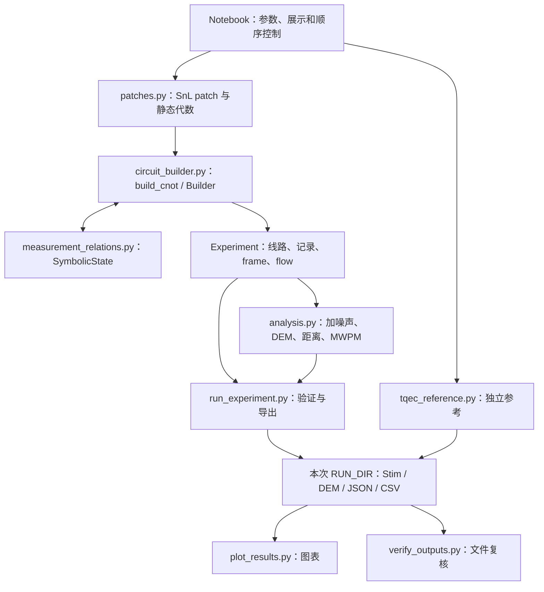
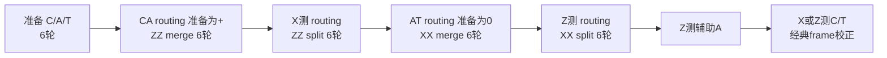

# defective_cnot_d3_walkthrough：逐步实现与正确性核验

> 跟着 notebook 的真实执行顺序，理解缺陷 patch 如何变成完整 CNOT 物理线路，以及各项检查究竟验证了什么。

本文对应 2026-10-15 读取的源文件，入口是 [defective_cnot_d3_walkthrough.ipynb](../defective_cnot_d3_walkthrough.ipynb)。源码位置采用“文件链接 + 行号”；notebook 采用 **C1～C22 表示第几个代码单元**，同时给出包含 Markdown 的实际 cell 序号，均从 1 开始。

本次实际运行了现有测试和原始 notebook：**27 项测试通过，22 个代码单元全部执行，12 组 × 100,000 shots 完成**。在本文描述的输入、几何、时序和噪声范围内，没有发现与预期行为不符的问题。健康 X/Z 线路的 DEM 距离为 3，缺陷 X/Z 为 2。详细证据、独立补充核验及结论边界见第 12 节。

## 阅读路线

- 第 1～3 节：弄清实验目标、模块分工与 notebook 索引。
- 第 4～7 节：沿执行过程理解参数、patch 和物理门。
- 第 8 节：重点理解测量关系、detector、四个 flow 和 Pauli frame。
- 第 9～11 节：理解噪声、距离、MWPM、统计和导出。
- 第 12～15 节：查看实测证据、复跑命令、易错点和速查表。

## 1. 这个实验实际在做什么

三个 surface-code patch 分别承载控制 C、辅助 A 和目标 T。A 从逻辑 `+` 开始，通过 **ZZ merge/split → XX merge/split → 测量 A**，将 C/T 关联为逻辑 CNOT。输出的随机 Pauli 副作用通过经典测量记录计算并校正。

指定永久缺陷是 C 的中心数据位置 `(3,11)`。它始终不参与操作；健康比特仍可发生电路级随机 Pauli 错误。两者分别通过 **改变 patch** 和 **给线路加噪声** 实现。

需要分清三个问题：

| 问题 | 代码中的回答 | 不能直接推出的结论 |
|---|---|---|
| 静态 patch 还能编码什么？ | 逻辑数、gauge 数、dressed CSS 距离 | 完整操作的时空故障距离 |
| 带测量的操作是否实现预期 CNOT？ | 带符号 flows、真值表、Bell parity | 任意噪声下的通用容错认证 |
| 指定噪声与 decoder 下有多可靠？ | 完整实验的解码失败率及区间 | 单个 CNOT 的平均 gate infidelity、阈值 |

本文把 stabilizer 称为“稳定子”，gauge check 保留英文。gauge check 的单次结果可以随机；某些 gauges 的乘积则给出稳定子信息。可把它理解成：两份各自变化的记录仍可能保持一个固定的相对关系，检查的是关系是否被破坏。

## 2. 模块分工和数据流



SnL 负责寻找缺陷后的校验结构；本目录的 `Builder` 负责将各阶段接成完整物理线路。**主 CNOT 不经过 TQEC 编译器**，也不使用 SnL 的 memory 线路拼接。TQEC 在 C20 中另行生成参考。

| 对象 | 关键内容 | 后续用途 |
|---|---|---|
| `Check` | `basis/data/ancilla/gauge` | 安排每轮局域校验 |
| `Stabilizer` | `basis/data/checks`：稳定子支持及测量组成 | 静态代数、check 乘积与距离核验 |
| `Boundary` | `name/basis/data/component`：有序数据路径与可终止错误串类型 | 选择和核验编码边界 |
| `Patch` | 数据位置、checks、稳定子、边界、bare logical、距离 | 一个逻辑比特的编码快照与分类核验 |
| `Builder` | Stim 线路、坐标映射、测量记录、两个符号状态 | 逐门生成完整实验 |
| `Experiment` | 主线路、operations、stages、selectors、frames、Choi harness | 加噪声、采样、检查、导出 |
| `STATISTICS` | 12 个字典，含计数、率、区间、seed | JSON/CSV、图表 |

这些对象在同一 notebook 内核中传递。绘图、TQEC 和最终文件复核通过 `subprocess.run` 调用现有脚本，使用同一个 Python 解释器和本次输出目录。

## 3. 22 个代码单元的执行索引

| 代码单元 / 实际 cell | 做什么 | 主要函数或状态 |
|---|---|---|
| C1 / 3 | 定位目录、检查内核、导入、表格工具 | `EXPERIMENT_DIR`、`show_table` |
| C2 / 5 | 参数、源码指纹、独立运行目录 | `tree_hash`、`CONFIG`、`RUN_DIR` |
| C3 / 7 | 健康/缺陷共十个阶段 patch | `build_patches`、`Patch.audit` |
| C4 / 9 | 展示 gauges、super-stabilizers 和交替时序 | `round_checks` |
| C5 / 11 | 四条完整主线路及资源统计 | `build_cnot`、`show_stage` |
| C6 / 13 | 查看准备阶段 | `show_stage(exp,'prepare')` |
| C7 / 15 | 查看 CA routing 和 ZZ merge | `route_ca` |
| C8 / 17 | 查看 ZZ split | `show_stage` |
| C9 / 19 | 查看 AT routing 和 XX merge | `route_at` |
| C10 / 21 | 查看 XX split、辅助及输出读出 | 三个阶段 |
| C11 / 23 | 四个 signed flows 和输出 frame | `verify_native_flows`、`bits` |
| C12 / 25 | 主线路无噪声和 16 组基输入真值表 | `validate_noiseless`、`corrected_output_bits` |
| C13 / 27 | 四条 `+0` 输入的 Bell 检查线路 | `BELL` |
| C14 / 29 | 四条加噪声线路及两类 DEM | `add_noise`、`detector_error_model` |
| C15 / 31 | 故障距离及 witness | `distance_audit` |
| C16 / 33 | 12 组采样、MWPM、checkpoint | `sample_decode` |
| C17 / 35 | 显示率、分项率及区间 | `STATISTICS` |
| C18 / 37 | 导出主线路、patch、SnL memory、Bell 和统计 | `export_experiment`、`export_patches` |
| C19 / 39 | 从刚生成的数据作图 | `run_existing_script`、`plot_results.py` |
| C20 / 41 | 独立 TQEC k=1 参考 | `tqec_reference.py` |
| C21 / 43 | 重新读文件验证并写完成标志 | `verify_outputs.py`、`NOTEBOOK_COMPLETION` |
| C22 / 45 | 用小例子理解 hyperedge 距离 | `low_weight_distance` |

C6～C10 是对 **C5 已经生成的同一条线路** 做阶段检查，并没有逐单元重新追加门。`show_stage` 的门计数是操作批次数，一次批量 CX 不等于只做了一对 CX。修改生成器后，需要重新运行 C5 及所有依赖它的单元；最稳妥的是重启内核后 Run All。

## 4. C1～C2：先固定环境、来源和实验参数

C1 从当前目录及父目录寻找同时存在 `patches.py` 和 `circuit_builder.py` 的目录，然后加入 `sys.path`。它要求 Python 3.12，而且 `sys.prefix` 必须是项目内的 `.conda/envs/defective-cnot-d3`。

先导入 [patches.py](../patches.py):10，是为了设置项目内的绘图/TQEC 缓存和 SnL 导入路径。随后导入 Stim、PyMatching 及本目录函数。`show_table` 只负责 HTML 展示，并对单元格内容做转义。

C2 的参数关系如下：

| 参数 | 默认值 | 实际影响 |
|---|---|---|
| `SHOTS` | 100,000 | 每组 noisy 采样次数 |
| `PROBABILITIES` | `1e-4,1e-3,3e-3` | 三个物理噪声点 |
| `SEED` | 20261013 | 通过案例、读出基和 p 索引派生采样 seed |
| `NOISELESS_SHOTS` | 1024 | notebook 直接调用的部分无噪声检查 |
| `CONFIG['stage_rounds']` | 6 | 记录设计；实际轮数来自 `Builder.rounds(count=6)` |

`PROBABILITIES` 目前需要保留 **三个不同的正概率点**：C16 固定断言 12 组，C21 的验证器也固定要求 12 个不同组合；作图横轴同样针对默认三个点。只改 p 列表长度会导致后续不相容。

源码核验包括 SnL zip 的 SHA-256，以及 SnL/TQEC 所列文件的树指纹。[prepare_sources.py](../prepare_sources.py):12 的 `tree_hash` 按文件名排序，将“文件名、零字节分隔符、文件内容”一起哈希。它检查 `sources.json` 列出的文件，不是检查目录中一切可能的额外文件。

`RUN_DIR` 使用 UTC 时间戳和微秒创建，`exist_ok=False` 防止覆盖。C2 先写 `config.json`；C16 每完成一组写 checkpoint；C21 最后才写 `notebook_completion.json`。目录存在本身不代表全部流程完成。

## 5. C3～C4：从缺陷位置得到可测量的 patch

### 5.1 build_patches 的实际步骤

入口是 [patches.py](../patches.py):116。它构造以下固定几何：

| patch | 数据坐标范围 | 用途 |
|---|---|---|
| C | x={1,3,5}，y={9,11,13} | 控制 |
| A | x={1,3,5}，y={1,3,5} | 辅助 |
| T | x={9,11,13}，y={1,3,5} | 目标 |
| CA | x={1,3,5}，y={1,3,…,13} | ZZ merge 期间 |
| AT | x={1,3,…,13}，y={1,3,5} | XX merge 期间 |

1. 用 `RotatedSurfaceCode(size, sw_offset=...)` 构造每个健康矩形。
2. 缺陷案例仅对 C、CA 调用 SnL 的 `make_defective_patches`，数据缺陷集合为 `{(3,11)}`，ancilla/link 缺陷集合为空。
3. 设置 `repurpose_ancillas=True, add_padding=False`；候选按最小方向距离降序、距离和降序、数据数升序选择首个。
4. `_convert` 把上游对象转为本目录 `Patch`，用 `audit(compute_distances=False)` 检查基础数据、subsystem 结构与一个逻辑比特的维数；精确距离和时间关系在 Notebook 中明确启用。

上游入口在 [defects.py](../third_party/snl/defects_module/defects.py):401：寻找、筛选有效策略后生成 `DefectiveSurfaceCode`。本目录只支持这一指定中心缺陷；其他永久缺陷坐标会触发 `NotImplementedError`。

`_convert` 将一个 super-stabilizer 拆成实际要测的 gauges，同时保留完整稳定子支持；将上游方向距离按 `vertical_logical` 转成 X/Z 距离。当前固定布局为 `{'X':vertical,'Z':horizontal}`，交换上游方向时也会正确交换映射。它还通过 `_boundaries` 读取上游变形路径；健康矩形采用显式矩形边界，缺陷对象缺少真实路径时会拒绝转换。

`Patch.stabilizers` 保存不可变的 `Stabilizer` 数据类对象，通过 `.basis` 和 `.data` 读取类型和数据支持，`.checks` 保存测量组成。普通稳定子对应一个普通 check；缺陷 C 的超级稳定子对应两个同类型 gauges。这些 `Check` 对象也由 `Patch.checks` 引用，供每轮调度使用。`audit()` 检查对象引用、类型及 check 乘积与稳定子的关系。该关联保存在内存对象中；导出到 `patches.json` 时，稳定子继续使用原有的 `[basis, data]` 结构。

### 5.2 为什么四个 gauges 不能每轮一起测

缺陷 C 的四个 weight-3 gauges 是：

| 类型 | 测量辅助位置 | 数据支持 |
|---|---|---|
| X | (4,10) | (3,9)、(5,9)、(5,11) |
| X | (2,12) | (1,11)、(1,13)、(3,13) |
| Z | (4,12) | (3,13)、(5,11)、(5,13) |
| Z | (2,10) | (1,9)、(1,11)、(3,9) |

部分异类型 gauges 反对易；同类型两个 gauges 的乘积为 weight-6 稳定子。[patches.py](../patches.py):51 因此规定：零基轮号 `0,2,4` 测 X gauges，`1,3,5` 测 Z gauges；普通 checks 每轮都测。这与 [SnL 论文 III.1.1 的数据缺陷方案](https://arxiv.org/html/2412.11504v1#S3.SS1.SSS1) 相符。

每个阶段均从 round=0 重新计数。当前每阶段六轮，结束在 Z gauge 相位，下一阶段重新从 X 开始，保持整个协议的交替相位。改变轮数时不能只改配置说明。

### 5.3 audit 如何确认“仍有一个信息逻辑比特”

`analyze_dimensions()` 将数据支持编码为整数 bit mask，用 GF(2) 消元计算全部 checks 生成的 gauge 群秩 `g` 和稳定子秩 `s`。它独立计算 X/Z gauge 对易矩阵的秩 `r`，并核对：
\[
r=\operatorname{rank}_{\mathrm{GF}(2)}(G_XG_Z^T)=(g-s)/2,\qquad k=n-s-r.
\]

`r` 是 gauge 自由度数，`k` 是信息逻辑比特数。缺陷 C 有 `n=8,s=6,g=8`，因此 `r=1,k=1`。这比只数“删掉了一个数据比特”更能确认编码结构。

`validate_subsystem()` 先检查稳定子由 checks 相乘得到、与所有 checks 对易、完整生成 gauge 群中心；还检查 bare X/Z logical 反对易，且与所有 gauges 对易。缺陷 C 的 bare logical 仍可选为左边一列 X 和下边一行 Z，权重均为 3。

编码空间维数为 `2**(n-s)`，其中信息维数为 `2**k`，gauge 维数为 `2**r`。缺陷 C 的四维空间分为一个信息比特和一个 gauge 比特；当前要求信息逻辑数恰为一。

### 5.4 为什么 bare logical 权重 3，距离却是 2

这里计算 **dressed CSS 距离**，允许乘上 gauge 算符改变逻辑代表。求 X 距离时，候选支持必须与全部 Z 稳定子对易，并与 bare Z logical 反对易；不要求与全部 Z gauges 对易。

`analyze_distances()` 对每个数据比特做一次动态规划：`best[syndrome]=(最小权重,支持mask)`；分别考虑不选/选当前比特。目标 syndrome 的稳定子部分全零，最后的逻辑判别位为 1。这样遍历的是所有数据支持，不是图上的最短路径近似。它返回精确值、算法和 witness；精确搜索可能随独立约束数量指数增长，可通过快速 audit 跳过。

| patch | 健康数据数 / (dX,dZ) | 缺陷数据数 / (dX,dZ) | 缺陷 gauge 数 |
|---|---|---|---|
| C | 9 / (3,3) | 8 / (2,2) | 1 |
| A、T | 各 9 / (3,3) | 各 9 / (3,3) | 0 |
| CA | 21 / (7,3) | 20 / (6,2) | 1 |
| AT | 21 / (3,7) | 21 / (3,7) | 0 |

例如缺陷 C 的 X 距离 witness 是 `(1,9),(3,13)`，Z witness 是 `(1,11),(5,9)`。具体支持由 `distance_witnesses` 导出。本次还独立穷举健康/缺陷 C 的全部 `2^9/2^8` 个支持，得到相同距离。

### 5.5 面向初学者：四个类型各自保存什么

`Patch` 可以理解为一块编码区域的说明书。它保存某一阶段的静态结构：`name` 是标签，`source` 是生成它的 SnL 原对象，`data` 是所有数据比特位置，`checks` 是测量清单，`stabilizers` 是编码约束，`logicals` 是逻辑 X/Z 代表，`distances` 是预期距离，`boundaries` 是有序边界段。数据和算符支持没有矩形限制；当前工厂只构造已验证的固定窗口，实际四邻接线路的可实现性另查。

`Check` 是一项测量任务：`basis` 决定测 X 还是 Z 的乘积，`data` 指明涉及哪些数据比特，`ancilla` 是执行测量的物理辅助比特，`gauge` 标记需要交替调度的缺陷 gauge。本项目 `ancilla` 与名称为 A 的逻辑 patch 处于不同层次。

`Stabilizer` 是一项编码约束。普通稳定子用一个 check 获得信息，超级稳定子通过多个同类型 gauge 的结果乘积获得信息。`.checks` 直接引用 `Patch.checks` 中的对象，保证两处描述一致。

`Boundary` 描述一整段同类型逻辑边缘。`name` 供后续操作引用；`basis` 指可终止的错误串类型；`data` 是沿边缘排列的数据比特中心；`component` 把若干边界段归入同一轮廓，当前工厂生成 outer。`.endpoints` 从路径计算首尾位置。同一轮廓按保存顺序首尾相接。边界路径不是精确多边形顶点，不应直接当作芯片几何轮廓。

例如缺陷 C 的 left 路径是 `(1,13) → (1,11) → (1,9)`，其 `basis='Z'` 表示 Z 错误串可以在这里终止；沿路径作用 X 则给出逻辑 X 的一个代表。边界类型与沿边逻辑类型相反。内部中心缺陷由超级稳定子处理，不自动添加编码边界。额外轮廓的路径可存储和做基本几何检查；当前逻辑边缘语义检查限定在 outer，不自动推断孔洞编码。

### 5.6 如何使用四类检查与分析

| 方法 | 做什么 | 结果 |
|---|---|---|
| `validate_data()` | 类型、坐标、支持范围、对象引用、边界连接与重叠 | 第三类：基础数据证据 |
| `validate_subsystem()` | 稳定子乘积、中心与完整性、bare logical 及 outer 边缘 | 第一类：subsystem CSS 代数证据 |
| `analyze_dimensions()` | 计算秩、gauge 对数、逻辑数与空间维数，要求 k=1 | 第二类：维数数据 |
| `analyze_distances()` | 精确搜索 dressed X/Z 最小权重及支持，比较声明值 | 第二类：静态距离证据 |
| `validate_measurements(rounds=6)` | 实际 Builder 线路的带符号流、跨轮 parity、逻辑保持、硬件冲突 | 第四类：时间关系证据 |
| `audit(...)` | 按依赖顺序组织上述步骤 | 兼容旧字段，按需附加四类报告 |

通常直接调用 `audit()`。默认执行基础数据、代数、维数和精确距离，保留旧返回结构；时间检查默认未执行。需要完整报告时：

```python
p = build_patches(True)['C']
report = p.audit(detailed=True, check_measurements=True)
print(report['validation'])

# 只做快速结构与维数检查；距离及时间项目明确标为 skipped。
fast = p.audit(compute_distances=False, detailed=True)

# 探索错误输入时返回失败证据，而不是遇到第一个问题就抛异常。
diagnostic = p.audit(raise_on_error=False, check_measurements=True)
```

四类报告键为 `data/subsystem/analysis/measurements`，analysis 下分别列出 dimensions 和 distance。每项状态为 passed、failed 或 skipped；前置条件失败后相关步骤跳过。默认遇到错误会抛带类别和说明的 `ValueError`。旧 JSON 不增加这些新字段，边界与测量关联目前保存在 Python 对象中。

`patch_measurements.validate_patch_measurements()` 复用 `Builder.check_round()`，不另写门序列。在未知数据输入上，用带符号 Stim flow 检查“指定算符 → 测量记录”，检查完整 gauge parity 的稳定子含义和跨轮相等，再检查逻辑 X/Z 保持。至少需要四轮以覆盖两次完整 X/Z 周期，默认六轮。它允许单个 gauge 随机；不依赖固定逻辑初态，也不进行 merge/split 逻辑证明。Stim 1.16 每次带符号 flow 检查的误接受上界为 `2^-256`。

### 5.7 工厂、转换及底层工具

`build_patches()` 是入口工厂，返回 C、A、T、CA、AT 五块区域。`False` 生成健康对照，`True` 对 C/CA 应用固定中心缺陷策略。CA、AT 在这里仅是静态区域定义。函数缓存结果，交互探索时请用 `dataclasses.replace` 创建修改副本，避免原地改写缓存对象。

`_convert(name, obj)` 是适配器：把上游位置转成坐标元组；创建可共享的 `Check`；按上游分组创建 `Stabilizer`；保存逻辑算符、距离和边界；最后快速核验结构。前导下划线表示内部方法，通常通过工厂间接使用。

`_boundaries(obj)` 负责边界转换，优先读取 SnL 的有序变形边缘。健康矩形缺少此信息时，依据其窗口生成 left/bottom/right/top；含缺陷对象缺少真实边界会报错。

`pauli_on(coords, basis, qubit_map, extra_qubits=0)` 把坐标描述变成 Stim 的 PauliString。它先建立全 I 算符，再按坐标到器件编号的映射，把指定位置改为 X 或 Z。extra_qubits 在末尾预留身份算符位置，供验证中的虚拟参考比特使用。

`rank(rows)` 用整数的二进制位表示向量，通过异或消元计算 GF(2) 秩，即独立关系的数量。`_coordinates` 检查坐标元组，`_require` 提供优化模式也不会关闭的显式异常，`_masks` 建立算符位掩码，`_parameters` 计算秩和 gauge 对易矩阵。这些内部工具服务于公开检查方法。

## 6. C5：Builder 如何发出物理门与记录

入口是 [circuit_builder.py](../circuit_builder.py):176：`build_cnot(defective,input_bases,output_basis,input_bits)`。C5 对健康/缺陷 × X/Z 各生成一条线路；默认 `input_bits=(0,0)`。

### 6.1 坐标、器件号、测量号是三种索引

- 坐标 `(x,y)` 表示硬件位置；数据为奇/奇坐标，测量辅助为偶/偶坐标。
- `qmap` 将所有阶段可能用到的健康位置排序并映射到连续器件号。
- `records[index]` 是从 0 开始的全线路绝对测量号；同一器件反复测量会产生多个记录。

`Experiment` 保留坐标映射、阶段、门操作及测量号，避免从最终 Stim 文本反猜协议。

### 6.2 emit 同时维护三份信息

[Builder.emit](../circuit_builder.py):85 每发出一个门，就更新 Stim 线路、`operations` 元数据和符号状态。遇到测量还会记录 `index/qubit/stage/round`，并根据符号关系决定是否添加 detector。

`full` 跟踪实际已知输入本征态；`choi` 用两个虚拟参考保留未知输入逻辑关系。当前 detector 和 flow 的推导都读取 `choi`；`full` 只是同步维护，并不直接决定这些输出。

`TICK` 结束一个时隙并保存 `idle = active - busy`。`active` 只包括已经 reset 且尚未最终读出的数据；未启用的 routing 不在其中。测量辅助每轮 reset/测量，通过实际门加噪，不属于这个数据 idle 集合。

### 6.3 一轮 syndrome 如何实现

[Builder.check_round](../circuit_builder.py):133 先根据 patch 名称和轮号取 checks，再发出：

```text
R 所有本轮测量辅助 → TICK
H X型辅助         → TICK
四个 CX 层        → 每层一个 TICK
H X型辅助         → TICK
M 所有本轮辅助    → TICK
```

每轮固定 8 个 TICK。X check 使用辅助作控制的 `CX(ancilla,data)`，配合前后 H 测 X parity；Z check 使用 `CX(data,ancilla)`，测 Z parity。

| CX 层 | X check 的 (dx,dy) | Z check 的 (dx,dy) |
|---|---|---|
| 1 | (1,-1) | (1,-1) |
| 2 | (-1,-1) | (1,1) |
| 3 | (1,1) | (-1,-1) |
| 4 | (-1,1) | (-1,1) |

只有该邻居属于 check 支持时才发门。该顺序是线路实现的一部分；仅验证邻接并不能证明任意重排都保留故障距离。当前顺序的距离由后面的完整线路检查核对。

`hardware_audit()` 检查：缺陷位置零操作；每条 CX 边满足 `|dx|=|dy|=1`；两个 TICK 之间同一器件没有门冲突。主线路不含 `MPP`，所有 parity 均由局域基本门测得。

## 7. C6～C10：五个 syndrome 阶段怎样连起来



### 7.1 准备：先物理初始化，再用校验建立码空间

[build_cnot](../circuit_builder.py):183 对 C/A/T 数据执行 R。输入基为 X 的 patch 再对所有数据执行 H；A 始终为 X 基。输入 bit=1 时，对 C/T 施加与输入基相反的 bare logical Pauli，翻转逻辑本征值。随后执行六轮 C/A/T 校验。

因此主线路的制备使用局域 reset、H、Pauli 和 syndrome rounds，包含制备成本。理想全局编码只出现在单独的验证 harness。

### 7.2 ZZ merge / split

[build_cnot](../circuit_builder.py):205 的集合差得到 CA routing：`(1,7),(3,7),(5,7)`。对它们 R 后 H，准备为 `+`；接着六轮测 CA 和 T，使 C/A 的 ZZ parity 进入测量关系。

split 时先以 X 读 routing，即 H、M，再恢复六轮 C/A/T checks。routing 测量和恢复校验产生的随机副作用会进入 frame；不能只摘一个 merge check 当作完整逻辑 parity。

### 7.3 XX merge / split

[build_cnot](../circuit_builder.py):215 得到 AT routing：`(7,1),(7,3),(7,5)`。只做 R，准备为 `0`；六轮测 C 和 AT，建立 A/T 的 XX parity。随后以 Z 测 routing，恢复六轮 C/A/T。

最后 Z 测 A 的全部数据，提取并保留相关逻辑测量信息；再根据 `output_basis` 测 C/T。`read_data` 在 X 读出前加 H，并在测量后将相应数据从 `active` 移除。

### 7.4 用一条实际线路对照阶段计数

以下是 **缺陷 Z 读出** 的实际记录，绝对测量号含两个端点：

| 阶段 | syndrome 轮数 | TICK 数 | 测量号 |
|---|---|---|---|
| prepare | 6 | 51 | 0～131 |
| zz_merge | 6 | 50 | 132～287 |
| zz_split | 6 | 50 | 288～422 |
| xx_merge | 6 | 49 | 423～578 |
| xx_split | 6 | 49 | 579～713 |
| ancilla_readout | 0 | 1 | 714～722 |
| output_readout | 0 | 1 | 723～739 |

30 轮 syndrome 共 240 TICK，制备、routing 和末端读出另占 11 个。X 输出多一次末端 H 的 TICK，故为 252。

| 主线路 | 登记器件数 | TICK | 测量数 | detector 数 | observable 数 |
|---|---|---|---|---|---|
| 健康 X / Z | 65 | 252 / 251 | 801 | 760 | 2 |
| 缺陷 X / Z | 64 | 252 / 251 | 740 | 671 | 2 |

器件数包含所有阶段可能使用的数据、routing 和辅助位置，不是初始三个 patch 的数据总数。健康与缺陷对照采用相同阶段及时长，但缺陷附近测量结构发生变化。

## 8. C11～C13：测量关系、detector 和 frame 的关键算法

### 8.1 整数 mask 怎样表达一个经典 parity

假设某个校正需要测量号 2、5、8，则 selector 为 `(1<<2) ^ (1<<5) ^ (1<<8)`。`bits(selector)` 按升序取出这些编号。两个 selector 异或就表示两个 parity 相加，重复出现的记录自动抵消。

Stim 的 `rec[...]` 则使用相对当前记录尾部的偏移。[Builder.emit](../circuit_builder.py):118 将绝对编号 i 转为 `i - circuit.num_measurements`。例如已经完成 10 次测量，记录 2 要写 `rec[-8]`。

### 8.2 SymbolicState 保存什么

[measurement_relations.py](../measurement_relations.py):24 的每行是 `(带符号Pauli, selector)`：该 Pauli 的本征值由所选记录的 parity 决定。Pauli 的正负号与经典 selector 分开保存。

- `unitary(fragment)` 用 Stim 的 Pauli 传播更新全部行。
- `reset(q)` 消除旧状态中依赖 q 的信息，再加入 `Z_q=+1`。
- `lookup(target)` 在二进制辛表示上消元，寻找生成元组合；再实际相乘恢复正负号。
- `forget(complementary_logical)` 删除一个已知逻辑本征值的信息，保留与其余约束相容的关系。

`measure(q,m)` 分两种情况：[measurement_relations.py](../measurement_relations.py):94。

| 情况 | 更新 | 返回值 / 用途 |
|---|---|---|
| 测量不由现有状态决定 | 移除反对易分量，加入标签 `1<<m` 的新行 | `None`，不直接生成 detector |
| 测量由现有生成元决定 | 计算旧 parity 和符号，用新测量替换一个生成元 | `(旧selector XOR 新记录, sign)`，形成确定性关系 |

“用新测量替换”保留了生成元张成空间，同时让后续关系优先依赖较新的记录。例如 Bell 对先测 m0，再测 m1，得到 `m0 XOR m1=0`；再次测同一比特得到 `m1 XOR m2=0`。现有 `test_relations.py` 专门检查这一行为。

detector 是这些确定性 parity **相对理想参考**的翻转。原始测量 bit、确定性 parity 的常数符号和 detector event 需要区分。生成器获取的 `sign` 不作为独立常数写进 DETECTOR 注释；Stim 使用线路参考确定基准，原始输出的符号则由 `corrected_output_bits` 显式处理。

### 8.3 为什么 detector 推导要使用 Choi 状态

如果只从已知 `00` 或 `++` 输入推断关系，可能把已知输入逻辑本征值误当成保护校验。代码在首次 syndrome 前，对 C/T 分别去掉该已知值，并加入与虚拟参考的 X/X、Z/Z 关联，参见 [circuit_builder.py](../circuit_builder.py):193。

这样 detector 来源于保留未知逻辑输入的符号状态；随机逻辑信息不会因为示例输入固定而被额外保护。两个参考只存在于符号跟踪和验证文件，主线路的 `qmap` 与噪声中均没有它们。

### 8.4 四个 signed flows 如何得到

在 A 读出之后、C/T 最终读出之前，代码查询以下输出与参考的相关性：

| 名称 | 期望传播 | 返回的测量 parity |
|---|---|---|
| XC | X_C → X_C X_T | fXC |
| XT | X_T → X_T | fXT |
| ZC | Z_C → Z_C | fZC |
| ZT | Z_T → Z_C Z_T | fZT |

每个 f 实际是 `(selector,sign)`。`choi.expectation` 推导证书后，`verify_native_flows` 用 **Stim 原生 `has_flow`** 重新核对，含常数符号。

验证 harness 用 `Tableau.from_stabilizers(...).to_circuit('elimination')` 制备理想初态，再重放首次 syndrome 到辅助读出的物理操作。因此它有理想全局门；导出的 `ideal_choi_verification_only_*.stim` 只用于 flow 核验，不用于噪声、距离或 LER。

### 8.5 从四个 f 解出输出 frame

考虑 X 相关性：XC 同时涉及输出 C/T，而 XT 只涉及输出 T，所以先由 fXT 得到 T 的符号，再异或 fXC 得到 C 的符号。Z 相关性同理。代码结果为：

\[
Z_C^{f_{XC}\oplus f_{XT}}Z_T^{f_{XT}},\qquad
X_C^{f_{ZC}}X_T^{f_{ZT}\oplus f_{ZC}}.
\]

读 X 时合并 Z frame，读 Z 时合并 X frame。`frames['X']` 指“X 读出需要的 frame”，不表示 frame 的 Pauli 类型就是 X。

不必实际发反馈 Pauli 门：[Experiment.corrected_output_bits](../circuit_builder.py):34 将最终逻辑数据 parity 与 frame selector 异或，再异或 sign。这与在测量前做相应 Pauli 校正在读出结果上等效。

缺陷 Z 线路的一个具体例子：

```text
C 的逻辑读出：m723 XOR m726 XOR m728；其 X frame 为空。
T 的逻辑读出：m731 XOR m734 XOR m737。
T 的 X frame：m271 XOR m273 XOR m274 XOR m275 XOR m419
             XOR m581 XOR m710 XOR m716 XOR m719 XOR m722。
本例两项 frame 的常数 sign 均为 0。
```

这里既出现 merge 记录，也出现 routing、恢复校验及辅助读出记录，直接说明了为什么需要跨阶段推导。

### 8.6 无噪声、真值表和 Bell 各自补上什么证据

C12 的 `validate_noiseless` 首先严格提取 DEM，拒绝非确定性 detector，再采样检查 detector events 和 observable flips 为零，并验证全部 signed flows。

随后对健康/缺陷、X/Z、四种输入共 16 个配置，用 **raw measurements 经 frame 校正后的实际 bit** 比较真值表：Z 基期望 `(c,c XOR t)`；X 基期望 `(c XOR t,t)`。X 基 bit=1 表示负本征态 `-`。每个配置采样 128 shots。

只检查 Stim 的 observable flips 为零不足以核对非零输入的真值表，因为 flips 相对于该线路自己的参考样本定义。显式比较校正后的 bit 避免这一遗漏。

C13 再对 `+0` 输入检查 Bell 输出：分别执行 X、Z 读出，校正后两个 bit 必须相等，即 XX 和 ZZ parity 均为正。每种读出独立采样，未在同一 shot 同时测 X/Z。结合 flows 与真值表，这提供了比只测 `00` 输入更完整的理想逻辑行为证据。

## 9. C14～C15：噪声、两类 DEM 与故障距离

### 9.1 add_noise 怎样保持测量索引不变

[analysis.py](../analysis.py):8 同步遍历主 Stim 和 `operations`；逐项核对门名与 targets。原有坐标、DETECTOR 和 OBSERVABLE 注释原样保留，只在物理门附近插入噪声：

| 位置 | 噪声 |
|---|---|
| R 后 | `X_ERROR(p)` |
| M | 改为 `M(p)`，翻转报告的测量结果 |
| H、X、Z 后 | `DEPOLARIZE1(p)` |
| CX 后 | `DEPOLARIZE2(p)` |
| TICK | 对元数据中 active 且 idle 的健康数据加 `DEPOLARIZE1(p)` |

没有新增测量，所以 selector 的绝对编号继续有效。`M(p)` 是经典结果翻转，不是以概率 p 跳过测量；`DEPOLARIZE2(p)` 的 p 是总非平凡两比特 Pauli 概率。

该模型不包括泄漏、串扰、漂移、非 Pauli 相干误差或器件间不同参数。TICK 是离散时隙，未赋予微秒等真实门时长。

### 9.2 为什么保留完整 DEM 和分解 DEM

完整 DEM 使用 `decompose_errors=False`，保留每个机制造成的全部 detector/logical 翻转，供低权距离搜索。分解 DEM 使用 `decompose_errors=True`，严格转换为供 PyMatching 使用的图表示。

所有主线路均要求 `allow_gauge_detectors=False`，分解要求 `ignore_decomposition_failures=False`；不通过容忍随机 detector 或忽略失败的方式绕过检查。这个 Stim → 分解 DEM → PyMatching 的接口方式见 [PyMatching 官方说明](https://pymatching.readthedocs.io/en/stable/#decoding-stim-circuits)。

### 9.3 low_weight_distance 为什么能穷尽权重 1 和 2

[analysis.py](../analysis.py):39 将每个正概率完整 DEM 机制编码为 `(D,L)` 两个 mask。组合机制的结果是 mask 异或：

1. 若某机制 `D=0,L≠0`，单机制就构成未检出逻辑错误，距离为 1。
2. 否则，两个机制的 D 相同且 L 不同，组合后恰有 `D1 XOR D2=0`、`L1 XOR L2≠0`，距离为 2。
3. 若都不存在，只能报告下界 3；并未继续穷举三机制以上。

按 D 分组比较 L 就能完成第二步，不必遍历所有机制对。同 D 同 L 的不同位置不会提供新的权重 2 逻辑 witness，因此去重不影响这个判定。

C22 的两个机制均触发 D0、D1、D2，其中一个额外翻转 L0。二者组合后 detector 全部抵消、L0 保留，距离为 2；不能把各个 detector 分量当成相互独立的故障。

### 9.4 怎样从“下界”得到这次的确定距离

`distance_audit` 再调用 `shortest_graphlike_error(ignore_ungraphlike_errors=True)`，只在原有 graphlike 机制里找 witness；跳过 hyperedges 会限制搜索，得到的是上界。该参数的保证见 [Stim 1.16.0 API](https://github.com/quantumlib/Stim/blob/v1.16.0/doc/python_api_reference_vDev.md#stim.Circuit.shortest_graphlike_error)。

| 线路 | 完整 DEM 低权搜索 | graphlike 上界 | 本例结论 |
|---|---|---|---|
| 健康 X / Z | 无权重 1、2，故下界 3 | 3 / 3 | 3 / 3 |
| 缺陷 X / Z | 无权重 1，找到权重 2 | 2 / 2 | 2 / 2 |

缺陷 X 的完整机制 witness 为 `D33` 和 `D33 L0`；缺陷 Z 为 `D12` 和 `D12 L0 L1`。机制概率可能合并多个等效线路位置，并不等于单个物理门的 p；另存的 graphlike witness 给出代表性物理故障位置解释。

这些距离属于 **当前读出线路的未分解 Stim DEM 独立机制模型**。它们不自动等于所有物理通道、任意输入及任意读出的通用门距离。距离 2 也不能保证纠正任意单故障。

## 10. C16～C17：采样和 MWPM 怎样变成失败率

[analysis.py](../analysis.py):97 的 `sample_decode` 先从严格分解 DEM 构造 `Matching`，然后从 **noisy 物理线路** 采样；没有将采样源改成独立图边。

```text
detectors, observables = sampler.sample(..., separate_observables=True)
predicted = matching.decode_batch(detectors)
residual = predicted XOR observables
decoded_any += 每行 residual 至少一位为 1 的 shot 数
```

每批最多 10,000 shots。主线路的 `observables/predicted/residual` 都有两个输出列。`raw` 是 observable flips，其中已经并入测量 frame；`decoded` 再扣除了 decoder 预测。raw 并非未处理 frame 的物理读出。

`decoded_any_failures` 统计 C 或 T 至少一个失败；两个都失败的 shot 只计一次。分项失败计数分别统计两列，不能直接相加作为整体失败数。普通 MWPM 未开启 correlated matching，分解机制间的相关性没有被最优处理。

seed 为 `20261013 + 100*case_index + 10*basis_index + p_index`。同机、同 Stim 版本、同采样调用顺序和批次可重复；改变 SIMD、版本或批次不承诺逐 bit 一致，见 [Stim 采样 API](https://github.com/quantumlib/Stim/blob/v1.16.0/doc/python_api_reference_vDev.md#stim.Circuit.compile_detector_sampler)。

对 k 次失败、n shots，估计率是 `k/n`。[wilson_interval](../analysis.py):86 使用 z≈1.959964 的 95% Wilson 二项区间；即使 k=0，上界也大于零。本次用 SciPy 的 Wilson 实现另行核对了 48 个导出区间。

本次完整重跑得到以下 decoded “至少一个输出失败”率，与原 `results/summary.json` 中全部 12 组统计字典逐字段相同：

| p | 健康 X | 缺陷 X | 健康 Z | 缺陷 Z |
|---|---|---|---|---|
| 0.0001 | 0.187% | 3.183% | 0.191% | 2.771% |
| 0.001 | 9.714% | 27.996% | 8.824% | 27.234% |
| 0.003 | 46.898% | 57.441% | 44.660% | 62.425% |

每个数的分母均为 100,000。指标包含制备、30 轮 syndrome、merge/split 和读出；251/252 个时隙中的 idle noise 也在内。不能直接把这个数写成“CNOT 门的平均不保真度”。三个 p 点不足以验证阈值或拟合渐近标度。

## 11. C18～C21：导出、绘图、参考和文件复核

### 11.1 每种导出物该看什么

| 文件 | 用来理解/复核什么 |
|---|---|
| `config.json` | 参数、版本、来源、seed 规则 |
| `healthy/`、`defective/` 下 `cnot_X/Z.stim` | 完整无噪声物理线路 |
| `cnot_X/Z.noisy.stim` | 固定 p=0.001 的导出线路；统计另含三个 p 点 |
| `cnot_X/Z.full.dem`、`.matching.dem` | 完整机制与 matching 表示 |
| `cnot_X/Z.metadata.json` | 坐标、门、阶段、记录、selector、frame、flow、距离 |
| `patches.json` | gauges、稳定子、bare logical、距离 witness |
| `ideal_choi_verification_only_X/Z.stim` | 单独的逻辑 flow 验证 harness |
| `snl_memory_X/Z.stim`、`bell_X/Z.stim` | 上游策略与 Bell 行为的辅助检查 |
| `summary.json`、`statistics.csv` | 完整统计/扁平统计 |
| `delivery_validation.json`、`notebook_completion.json` | 文件复核及流程完成记录 |

`export_experiment` 位于 [run_experiment.py](../run_experiment.py):40；除了保存文件，还重新执行无噪声和距离检查。C18 断言其距离结果等于 C15，防止内存状态与导出步骤出现偏差。`write_stim` 使用 Python UTF-8 I/O，支持 Windows 中文路径。

### 11.2 SnL memory 的“六轮”与主线路不同

[export_patches](../run_experiment.py):67 调用上游 [memory_program](../third_party/snl/defects_module/utils.py):23。其 `rounds=6` 是在 `initialize` 之后额外执行六次 check：健康初始化自带 **一轮**，缺陷初始化自带 **两轮**，因此分别共七轮、八轮 syndrome extraction，之后才最终读出。

主 CNOT 则由本目录 `Builder` 明确安排每阶段六轮。这两种计数不能混用；memory 只作 SnL 缺陷策略检查，不是 CNOT 性能对照。

### 11.3 图表和 TQEC 参考如何与主实验隔开

C19 的 [plot_results.py](../plot_results.py):19 读取本次 `RUN_DIR/summary.json`，输出 PNG/SVG、布局和 manifest。图中保留所有观测点，显示 Wilson 区间，不做拟合。

C20 的 [tqec_reference.py](../tqec_reference.py):10 依次调用 `gallery.cnot(Basis)`、`compile_block_graph`、`generate_stim_circuit(k=1)` 和 TQEC 的 `uniform_depolarizing`。它在子进程运行，保留 Windows 多进程所需的 `__main__` 保护。

参考 X/Z 均为 83 TICK，登记到最大编号为 81 个器件位置，graphlike 上界均为 3。它与本目录主线路的几何、时序、噪声和可观测量定义不同，不能作为健康/缺陷曲线里的配对健康数据。

### 11.4 verify_outputs 做了什么，又留下什么

[verify_outputs.py](../verify_outputs.py):11 从磁盘重新读取文件，检查主线路 hash、测量数、detector 数、器件坐标、CX 邻接和时隙冲突；重新运行无噪声、严格 DEM 和四个 signed flows；核对 12 组统计的计数关系。TQEC 文件也重新做无噪声采样。

它读取 metadata 中的距离，**没有重新搜索距离**；区间检查是“包含估计率”，**没有重算 Wilson 公式**；它也不读取 CSV。因此“交付复核通过”不等于这些项目全部独立重算。本次额外脚本补做了导出 noisy 线路的距离、8 份 DEM、CSV/JSON 对照及 SciPy Wilson 核对。

## 12. 本次实际验证证据与结论边界

本次核验日期：2026-10-15。环境为 Python 3.12.15、Stim 1.16.0、PyMatching 2.4.0、NumPy 1.26.4、TQEC 0.2.0。原代码、原 notebook、tests、notebook_tools 和历史 results 共 77 个文件的指纹保持一致。

| 验证层次 | 实际执行和结果 | 对应证据 |
|---|---|---|
| 现有回归测试 | `python -m pytest -q`：27 passed，30.45 秒 | [tests/](../tests/)；[本次命令记录](../.planning/2026-10-15-walkthrough-docs/progress.md) |
| 独立静态检查 | 穷举健康/缺陷 C 的全部数据支持，距离分别 (3,3)/(2,2) | [完整核验报告](validation/2026-10-15/verification.json) |
| 符号关系交叉检查 | 64 条随机 4-qubit Clifford 线路，每条 80 个随机操作、128 shots；1030 个关系含 182 个负号关系全部符合 Stim raw samples | 同上，`symbolic_relations` |
| active/idle 检查 | 四条主线路独立重放 reset/测量/时隙，重算全部 idle 集合，一致 | 同上，`circuits` |
| 干净内核完整运行 | 全部 22 单元；原始参数 120 万 noisy shots；0 error outputs | [另存的执行 notebook](validation/2026-10-15/executed_walkthrough.ipynb) |
| 统计复现 | 12 组统计字典全部逐字段等于历史结果 | 同上报告，`notebook` |
| 导出物再计算 | CSV/JSON 的 12 行一致；48 个 Wilson 区间与 SciPy 相符；8 份 DEM 的机制结构完全一致、数值符合导出精度；四条距离重算相符 | [导出物核验报告](validation/2026-10-15-artifacts/verification.json) |

这次运行的新产物位于 [notebook_runs/20261015T062709_817016Z](../notebook_runs/20261015T062709_817016Z/)，包括本次 [summary](../notebook_runs/20261015T062709_817016Z/summary.json)、[文件复核](../notebook_runs/20261015T062709_817016Z/delivery_validation.json) 和 [完成记录](../notebook_runs/20261015T062709_817016Z/notebook_completion.json)。原始 notebook 及历史结果没有覆盖。

DEM 文本往返后，概率可能在浮点末位略有变化。本次 8 份文件的最大参数差为约 `5.2e-18`；补充核验要求机制类型/targets 完全相同，参数绝对误差不超过 `1e-15`，没有放宽结构检查。

可以据此确认：当前实现按声明的几何和时序执行了指定 CNOT 协议；理想逻辑关系及指定噪声实验得到多层相符证据；健康/缺陷 X/Z 的当前 DEM 距离分别为 3/2。额外的随机符号关系检查是有限样本交叉验证，不是对 `SymbolicState` 所有输入的形式化证明。

**⚠️ 未验证的推广结论**：任意位置/多个永久缺陷；Y 基或任意输入态的公开实验接口；通用信道距离及任意单故障容错；泄漏/串扰等模型；最优 decoder、correlated matching 性能；阈值和渐近指数。现有代码及本次证据均不足以支持这些结论。

## 13. 如何自己跟着运行和核对

从工作区根目录进入实验目录，使用已经建好的项目 Python。下面前两条分别对应本次执行过的测试和完整核验方式；复核脚本默认创建新的时间戳目录，避免复用既有 `--out`。

```powershell
Set-Location -LiteralPath './实验代码/defective_cnot_d3'
& './.conda/envs/defective-cnot-d3/python.exe' -X utf8 -m pytest -q
& './.conda/envs/defective-cnot-d3/python.exe' -X utf8 'docs/validation/verify_walkthrough.py' --execute-notebook
```

这份 [补充脚本](validation/verify_walkthrough.py) 清空内存中的旧 outputs，启动干净内核执行原始 cells，再把执行版另存到核验目录；**不改 notebook 的参数或 source**。完整执行默认 120 万 shots，另含真值表、Bell、无噪声和 TQEC 检查。

如只核查已经导出的这次结果，可运行本次执行过的 `--results` 路径：

```powershell
& './.conda/envs/defective-cnot-d3/python.exe' -X utf8 'docs/validation/verify_walkthrough.py' --results 'notebook_runs/20261015T062709_817016Z'
```

复核脚本会额外跑静态支持穷举、随机符号关系和 idle 检查；`--results` 再核对该目录的 CSV、区间、DEM 和距离。更换结果目录时应保持本例 12 组、两种读出的文件结构。

若希望交互阅读，打开原 notebook，选择项目 Conda 内核，按 C1～C22 顺序执行。建议先看 C3/C4 的 patch，再看 C5 的资源和 C6～C10 的阶段，随后专门对照 C11 与 metadata 中的 selector。

本次没有重新创建 Conda 环境，安装流程未重跑；环境重建说明见 [原 README](../README.md)。另需注意，现有 `notebook_tools/execute_walkthrough.py` 会把输出写回原 notebook；本次为保留原文件使用了上述另存脚本。

## 14. 阅读和改实验时最容易误解的地方

| 容易误解的说法 | 按当前源码应怎样理解 |
|---|---|
| C6～C10 逐步生成了门 | 门在 C5 一次生成，后续逐段展示 |
| operations 的 round 对所有门都是独立轮号 | routing/读出操作会沿用最近的 check 轮号；阶段边界应看 stage |
| 修改 CONFIG 的轮数就改变了线路 | 实际轮数在 `Builder.rounds`；CONFIG 只是记录 |
| 四个 gauges 等于四个额外逻辑比特 | 缺陷 C 仍是一个信息逻辑比特加一个 gauge 自由度 |
| 单个 gauge 随机，detector 就应允许随机 | detector 由确定性关系构造，严格禁止 gauge detectors |
| bare logical 长 3，所以距离必为 3 | dressed 等价类允许权重降至 2 |
| raw 率是尚未修正 frame 的率 | frame 已并入 observable，raw 只表示尚未 MWPM |
| graphlike 搜索结果本身就是完整距离 | 需要与完整 DEM 的下界/witness 配合 |
| Bell 输出两个 bit 相同就代表两个输出确定为 0 | 两者可以共同随机；确定的是校正后的 parity |
| 导出的 noisy Stim 包含所有 p 点 | 文件固定 p=0.001，统计在三条不同 p 线路上采样 |
| SnL memory 的 rounds=6 就是总六轮 | 健康/缺陷初始化另有一轮/两轮 |
| TQEC 与 healthy 是同一对照 | TQEC 是独立参考，主 healthy 才是配对对照 |

`build_patches` 和 `build_cnot` 均使用 `lru_cache`，返回的内部字典/对象也可变。交互探索时不要就地修改缓存对象；改生成器后重启内核，避免旧模块或旧对象混进新实验。

## 15. 源码速查和阅读完成检查

| 你要找的实现 | 位置 |
|---|---|
| SnL 策略与方向距离转换 | [patches.py](../patches.py):98、116 |
| 秩、逻辑数与最小权重支持 | [patches.py](../patches.py):21、55 |
| Pauli mask、消元、测量更新 | [measurement_relations.py](../measurement_relations.py):11、58、94 |
| 发门、测量关系与 detector | [circuit_builder.py](../circuit_builder.py):85 |
| 八时隙校验与局域 CX 顺序 | [circuit_builder.py](../circuit_builder.py):133 |
| 完整协议、Choi 关联、输出 frame | [circuit_builder.py](../circuit_builder.py):176、193、225 |
| 显式校正实际读出 | [circuit_builder.py](../circuit_builder.py):34 |
| 加噪声、完整 DEM 低权搜索 | [analysis.py](../analysis.py):8、39、68 |
| Wilson 区间与 MWPM 统计 | [analysis.py](../analysis.py):86、97 |
| 无噪声、主线路和上游 memory 导出 | [run_experiment.py](../run_experiment.py):28、40、67 |
| 独立 TQEC / 文件复核 | [tqec_reference.py](../tqec_reference.py):10；[verify_outputs.py](../verify_outputs.py):11 |

- [ ] 能指出 C/A/T 与两段 routing 的硬件坐标。
- [ ] 能解释缺陷 C 为什么是 `k=1,r=1,dX=dZ=2`。
- [ ] 能从绝对测量号换算 `rec` 偏移，并读懂 selector 的 XOR。
- [ ] 能解释随机 gauge 测量与确定性 detector 的区别。
- [ ] 能从四个 flows 推导两种读出的 frame。
- [ ] 能区分完整 DEM 机制、分解分量、距离上下界。
- [ ] 能说明失败率的分母与完整实验范围，并定位原始计数和区间。
- [ ] 能把“当前实现已验证”与“尚未验证的物理推广”分开表述。
