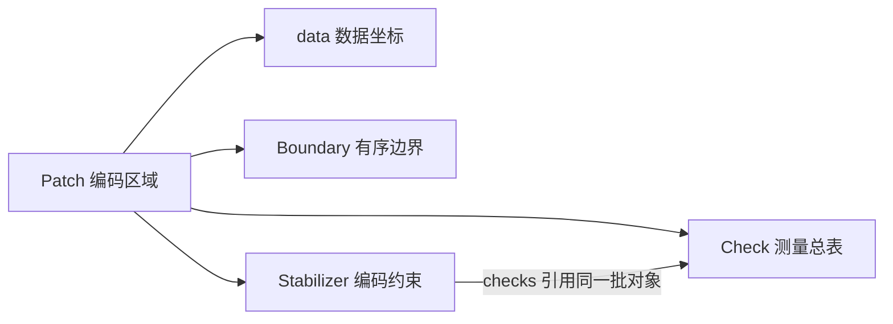

# Patch 数据类与关键函数说明

> 从一块编码区域包含哪些信息出发，理解 `patches.py` 的数据类、SnL 转换过程，以及四类检查与分析的用途。

本文对应 2026-10-23 的项目实现。读者只需了解基本的 Python 变量、列表和函数；量子纠错术语在使用时解释。
示例从项目根目录运行，使用项目 Conda 环境。每个 Python 代码块都包含自己的导入，可以单独执行。

## 1 从物理比特到逻辑 patch

表面码使用多个数据量子比特共同保护逻辑信息，再利用测量辅助比特检查数据之间的关联。
单个物理比特的状态可以出错，而编码区域通过这些关联提供错误信息。

可以把 `Patch` 理解为一块编码区域的说明书：数据位置是器件清单，checks 是测量任务，稳定子是编码约束，边界是可定位的编码边缘。
说明书保存结构，量子线路执行测量，测量记录保存本次运行的结果。

本项目的一个 `Patch` 表示某一阶段支持一个信息逻辑比特的 CSS 编码区域。
CSS 表示这里的基本算符可以分成纯 X 型与纯 Z 型两类。
它还可能包含 gauge 自由度，即不承载目标逻辑信息、允许发生变化的内部自由度。

源码入口是 [patches.py](../patches.py)。其中类型定义位于 `patches.py:50–93`。



## 2 阅读数据类需要的 Python 知识

`@dataclass` 会自动生成初始化、显示和比较等常用方法，方便把一组有关联的字段组织成对象。
`@dataclass(frozen=True)` 还会阻止创建后直接重新赋值字段。

`Boundary`、`Check`、`Stabilizer` 使用 frozen 数据类；`Patch` 是普通数据类，其字典字段也可以修改。
因此，检查函数仍需要确认字段与对象关联是否合法。

| 类型写法 | 含义 | 例子 |
|---|---|---|
| `tuple[int, int]` | 两个整数构成的坐标 | `(1, 9)` |
| `tuple[tuple[int, int], ...]` | 一组坐标 | `((1, 9), (3, 9))` |
| `tuple[Check, ...]` | 一组 Check 对象 | 一项或多项校验 |
| `dict` | 按键查找内容 | 用 `'X'` 查逻辑 X 的支持 |

“算符支持”指算符在哪些数据比特上不是 I。
例如支持 `((1,9),(3,9))` 上的 X 算符，表示两个位置上的联合算符，而其他位置作用 I。

## 3 Patch 保存哪些信息

定义位置：`patches.py:84`。

| 字段 | 内容 | 阅读时的用途 |
|---|---|---|
| `name` | 区域名称 | 区分 C、A、T、CA、AT |
| `source` | 原始 SnL 对象的引用 | 保留上游信息与上游 memory 实验能力 |
| `data` | 整块区域的数据比特坐标 | 建立算符和硬件坐标映射 |
| `checks` | 实际测量的 Check 总表 | 安排校验轮次 |
| `stabilizers` | 稳定子及其测量组成 | 描述编码约束 |
| `logicals` | 一对 bare 逻辑 X/Z 代表 | 操作或读出信息逻辑比特 |
| `distances` | 声明的 X/Z 静态距离 | 与独立距离计算比较 |
| `boundaries` | 按轮廓顺序保存的边界段 | 定位编码边缘 |

bare 逻辑算符与全部 gauge checks 对易，在 gauge 自由度上不起作用。
同一个逻辑作用可以选择不同的物理支持，因此 `logicals` 保存的是一组代表，不是所有可能的逻辑算符。

```python
from patches import build_patches

p = build_patches(True)['C']
print(p.name)          # C
print(len(p.data))     # 8
print(p.logicals)      # 逻辑 X/Z 的代表支持
print(p.distances)     # {'X': 2, 'Z': 2}
```

`Patch` 的坐标与算符支持没有矩形限制，可以描述有弯折或缺失位置的区域。
当前工厂只构造固定窗口与中心缺陷；其他几何的静态合法性和物理可执行性需要分别核验。
Patch 本身不保存 merge/split 的逻辑映射或测量结果。

## 4 Check 与 Stabilizer 为什么分开

### 4.1 Check 描述一项测量

定义位置：`patches.py:68`。

| 字段 | 含义 |
|---|---|
| `basis` | 测量的 Pauli 类型，当前为 X 或 Z |
| `data` | 该项测量涉及的数据坐标 |
| `ancilla` | 执行该项测量的物理辅助比特坐标 |
| `gauge` | 当前调度是否按缺陷 gauge 的 X/Z 相位选择它 |

例如 `basis='X'`、`data=((1,9),(3,9))` 表示测量联合算符 X(1,9)X(3,9)。
结果是一个整体的正负本征值，不会分别读出两个数据比特的完整状态。
参与的数据比特数称为权重，此例权重为 2。

`Check.ancilla` 是一个物理测量器件；名称为 A 的 patch 则是一整块辅助编码区域，两者层次不同。

### 4.2 Stabilizer 描述编码约束

定义位置：`patches.py:76`。字段为 `basis`、`data` 和 `checks`。
普通稳定子对应一个 check；当前缺陷 C 的超级稳定子通过两个同类型 gauge checks 的乘积获得信息。

以 X 超级稳定子为例：

\[
S_X=G_{X,1}G_{X,2}.
\]

单个 gauge 结果可以随机，但两者的组合仍能提供稳定子信息。
`Stabilizer.checks` 保存这两个具体测量任务，与 `Patch.checks` 引用相同的对象。

```python
from patches import build_patches

p = build_patches(True)['C']
s = next(s for s in p.stabilizers if s.basis == 'X' and len(s.checks) == 2)
print(s.data)                         # 超级稳定子的完整支持
print([c.ancilla for c in s.checks])   # [(4, 10), (2, 12)]
assert all(any(c is item for item in p.checks) for c in s.checks)
```

符号 `is` 在这里检查对象身份，说明两处关联同一项测量任务。
转换函数从上游读取稳定子支持；后续验证会检查它是否等于所关联 checks 的乘积。

## 5 Boundary 如何描述边界

定义位置：`patches.py:50`。

| 字段或属性 | 含义 |
|---|---|
| `name` | 可稳定引用的边界名称 |
| `basis` | 可在此终止的 Pauli 错误串类型 |
| `data` | 沿整段编码边缘排列的数据比特中心 |
| `component` | 所属轮廓，当前工厂生成 `outer` |
| `endpoints` | 从有序路径推导的首尾坐标 |

当前缺陷 C 的 left 为 `(1,13) → (1,11) → (1,9)`，其 `basis='Z'`。
这表示 Z 错误串可以在这里终止；沿整段 left 作用 X，则给出一个 dressed 逻辑 X 代表。
因此，可终止的错误串类型与沿整段边缘的逻辑算符类型相反。

```python
from patches import build_patches

p = build_patches(True)['C']
for b in p.boundaries:
    print(b.name, b.basis, b.component, b.endpoints)
left = next(b for b in p.boundaries if b.name == 'left')
assert left.data == ((1, 13), (1, 11), (1, 9))
assert left.basis == 'Z'
```

同一轮廓的各段按照保存顺序首尾相接。
坐标路径遵循本项目间距为 2 的旋转格点约定，可以转弯；这些数据中心并不是精确多边形顶点。
当前检查也不能代替一般多边形的完整几何验证。

中心失效位置由 gauge 和超级稳定子处理，不会仅因为缺少数据比特而自动增加边界。
额外轮廓可以保存路径并接受基础检查；当前沿边逻辑语义检查限定在 outer，内部孔洞编码不会被自动推断。

## 6 build_patches 如何构造五块区域

定义位置：`patches.py:357`。它返回一个以名称为键、Patch 为值的字典。
默认 `defective=True`，缺陷位置为 `DEAD=(3,11)`。
缺陷模式目前只支持该位置，其他永久缺陷请求会抛出 `NotImplementedError`。

### 6.1 固定窗口

| 名称 | 水平和竖直尺寸 | 数据网格起点 | 用途 |
|---|---|---|---|
| C | 3×3 | `(1,9)` | 控制区域 |
| A | 3×3 | `(1,1)` | 辅助区域 |
| T | 3×3 | `(9,1)` | 目标区域 |
| CA | 3×7 | `(1,1)` | C/A 合并阶段的静态区域 |
| AT | 7×3 | `(1,1)` | A/T 合并阶段的静态区域 |

每个方向的数据坐标间隔为 2。例如 C 的 x 为 1、3、5，y 为 9、11、13。
CA 还包含 routing 行 y=7；AT 还包含 routing 列 x=7。
尺寸是名义窗口，缺陷后的有效距离和活动数据数从重构结果读取。

### 6.2 健康模板与缺陷策略

每块区域先通过 SnL 的 `RotatedSurfaceCode(size, sw_offset=Pos(*offset))` 创建健康模板。
只有开启缺陷模式时的 C 和 CA 会进入 `DefectiveSurfaceCode.make_defective_patches()`。
其参数含义是：没有 ancilla 缺陷，一个数据缺陷，没有 link 缺陷；允许辅助比特重用，目标窗口不加 padding 辅助比特。
SnL 内部仍可以使用扩展窗口分析策略。

返回值包含找到的策略数量和经过过滤的候选列表。代码忽略数量，使用候选列表。
上游默认按最小方向距离和距离总和保留最佳策略组，本项目继续按以下顺序排序并取首项：

1. 最小方向距离越大越优先。
2. 前项相同时，两个方向距离总和越大越优先。
3. 前两项相同时，数据比特数越少越优先。

排序键中的前两项取负数，以便用从小到大的排序实现“距离越大越优先”。
这项选择依据是静态距离和数据数量，不包含完整线路故障距离或解码失败率比较。
如果没有合法策略，上游会抛出异常。

### 6.3 转换、返回与缓存

选定的上游对象通过 `_convert(name, raw)` 转成 Patch，放入结果字典。
该工厂建立区域描述，物理 merge/split 在后续线路中执行。

```python
from patches import build_patches

healthy = build_patches(False)
defective = build_patches(True)
assert set(healthy) == set(defective) == {'C', 'A', 'T', 'CA', 'AT'}
print([(name, len(p.data), p.distances) for name, p in defective.items()])
```

`@lru_cache(maxsize=4)` 最多缓存四组调用参数对应的结果，每组结果包含五块区域。
命中缓存会返回原来的字典及对象。交互探索时不要原地改写它们，可用 `dataclasses.replace` 创建副本。
修改构造代码后宜重启 Notebook 内核；`build_patches.cache_clear()` 只清除此函数的缓存。

```python
from dataclasses import replace
from patches import build_patches

p = build_patches(True)['C']
copy = replace(p, name='C_copy')
assert p.name == 'C'
assert copy.name == 'C_copy'
```

replace 是浅层替换，未替换的字段继续共享；需要改字典字段时应传入新的字典。

## 7 convert 如何适配 SnL 对象

内部函数 `_convert(name, obj)` 位于 `patches.py:333`，接收已经构造和选定的上游区域。
前导下划线表示内部方法，通常通过工厂间接调用。

### 7.1 建立 checks 与稳定子的对应关系

函数先准备 checks 和 stabilizers 两个列表，再按类型与辅助位置稳定排序上游稳定子。
排序保证重复运行的表示稳定，不决定量子门执行顺序。

对普通上游稳定子，循环只处理它本身；对 SuperStabilizer，循环处理其 gauges。
每个组成项从上游读取 Pauli 类型、数据位置和唯一辅助位置，创建本项目的 Check。
`only_ancilla` 要求具体 check 只有一个辅助位置，否则会报错。

这些 Check 被装入对应的 Stabilizer，也通过 extend 加入总清单。
两处引用相同对象；每个超级稳定子的分组来自 SnL 的 gauges，不是转换函数按空间距离重新猜测的。

### 7.2 转换坐标、逻辑算符与距离

上游 Pos 通过 `.x/.y` 转为坐标元组，PauliT 枚举通过 `.name` 转为 X/Z 字符串。
check 和稳定子的支持排序后保存；逻辑路径与边界路径保留原有顺序。

含缺陷对象提供 effective_distance 时优先使用它，否则使用 distance。
上游距离按水平、竖直方向表达，转换函数根据 vertical_logical 映射到 X/Z。
当前布局竖直逻辑为 X，因此缺陷 CA 的方向距离 `(2,6)` 转为 `{'X':6,'Z':2}`。

逻辑支持分别通过 `obj.logicals[PauliT.X]` 和 `obj.logicals[PauliT.Z]` 读取。
原对象同时保存在 Patch.source，转换过程保留其引用。

### 7.3 转换边界并快速核验

`_boundaries(obj)` 位于 `patches.py:313`，优先读取 SnL 的 deformed_logicals。
健康矩形没有变形路径时，根据 extent 构造 left/bottom/right/top，并统一为终止错误串类型。
缺陷对象缺少真实变形路径时会拒绝转换。

最后创建 Patch，并调用 `audit(compute_distances=False)`。
它检查基础数据、subsystem 结构与维数，不执行精确距离或时间关系验证。

## 8 转换使用了哪些 SnL 类型

| 上游类型 | 定义位置 | 转换时的作用 |
|---|---|---|
| RotatedSurfaceCode | [code_library.py](../third_party/snl/defects_module/code_library.py)，27 行 | 健康窗口及其稳定子、数据和逻辑算符 |
| DefectiveSurfaceCode | [defects.py](../third_party/snl/defects_module/defects.py)，87 行 | 缺陷策略结果、有效距离与变形路径 |
| Stabilizer | [base.py](../third_party/snl/defects_module/base.py)，155 行 | 类型、支持、辅助位置 |
| SuperStabilizer | 同文件，211 行 | 通过 gauges 保留测量组成 |
| Pos | 同文件，22 行 | 位置的 x/y 属性及整数排序表示 |
| PauliT | 同文件，113 行 | X/Z 类型枚举及逻辑字典键 |
| Pauli | 同文件，133 行 | 上游稳定子内部的“位置＋Pauli 类型”数据类 |
| CombinedCluster | [combined_clusters.py](../third_party/snl/defects_module/defect_strategies/combined_clusters.py)，24 行 | 间接提供策略、边界与距离信息 |

DefectiveSurfaceCode 继承 RotatedSurfaceCode；其 data_qubits 属性根据当前稳定子支持汇总活动数据。
因此，失效位置的排除来自上游重构结果，转换函数读取实际活动集合。
CombinedCluster 的边界和策略结果先装入缺陷对象，再由转换函数读取。

上游与本项目都存在名为 Stabilizer 的类型。上游类型是转换输入，本项目数据类是转换输出。
SnL 的 Pauli 和 CombinedCluster 是 dataclass；Pos、两种稳定子和两种编码区域是普通类，PauliT 是枚举。

## 9 四类检查与分析

### 9.1 基础数据合法性

`validate_data()` 位于 `patches.py:101`，先检查输入能否被后续算法正确解释。
它检查坐标格式、重复位置、支持是否属于 Patch.data、测量辅助是否与数据重合、对象引用是否完整。
逻辑算符和声明距离必须包含 X/Z，距离必须为正整数。

边界需要名称唯一、有序路径连通、同轮廓首尾相接；相邻段只在允许的端点相交，不同轮廓不共享数据位置。
同一稳定子内重复引用 check 会被拒绝。不同稳定子之间可以共享 checks，也允许冗余生成元，由秩分析处理依赖。

### 9.2 Subsystem stabilizer code 的代数合法性

`validate_subsystem()` 位于 `patches.py:184`，检查稳定子确实由关联 checks 相乘得到。
纯同类型 Pauli 在重复数据位置上相消，所以乘积支持采用对称差计算。

它还检查稳定子之间对易、每个稳定子与全部 checks 对易，以及稳定子完整生成 gauge 群中心。
最后核对 bare X/Z 反对易且与全部 checks 对易，并检查 outer 边缘的逻辑语义。
全部 checks 生成 gauge 群，包含普通 checks；gauge 群秩不等于 gauge=True 的条目数量。

当前采用正号纯 X/纯 Z 生成元约定，不表示一般混合 Pauli 或独立的稳定子本征值状态。

### 9.3 编码维数与静态距离

`analyze_dimensions()` 位于 `patches.py:218`。设数据数为 n，稳定子秩为 s，全部 checks 的秩为 g。
它通过 X/Z gauge 对易矩阵独立计算 gauge 比特数 r，并核对：

\[
r=\operatorname{rank}_{\mathrm{GF}(2)}(G_XG_Z^T)=(g-s)/2,\qquad k=n-s-r.
\]

当前要求 k=1。稳定子留下的空间维数为 `2**(n-s)`，可分成信息维数 `2**k` 与 gauge 维数 `2**r`。
缺陷 C 为 n=8、s=6、r=1、k=1：四维编码空间中，一个比特保存目标信息，一个比特是 gauge 自由度。
维数检查可以发现意外多出的信息自由度或过多约束。

`analyze_distances()` 位于 `patches.py:229`，计算静态 dressed CSS 距离，允许 gauge 等价变换。
搜索 X 错误时，要求它与 Z 稳定子对易、与 bare 逻辑 Z 反对易，再求最小数据权重；Z 情况相反。
动态规划返回精确距离、算法标识和最小支持 witness，并与声明距离比较。

```python
from patches import build_patches

p = build_patches(True)['C']
print(p.analyze_dimensions())
distance = p.analyze_distances()
assert distance['distances'] == {'X': 2, 'Z': 2}
print(distance['distance_witnesses'])
```

这个距离描述静态编码；完整线路中的故障传播和时间方向错误由线路分析处理。
精确动态规划的状态数可能随独立约束数量指数增长，所以它可以独立执行或被跳过。

### 9.4 时间上的测量关系

`validate_measurements(rounds=6)` 位于 `patches.py:256`，调用 [patch_measurements.py](../patch_measurements.py) 的 `validate_patch_measurements()`。
它复用真实的 Builder.check_round，而不是另写一套门序列。

验证先确认每个支持都被四邻接测量线路覆盖，再检查同轮 check 对易和辅助资源使用。
随后用带符号 Stim flow 验证“声明算符 → 测量记录”、稳定子的完整 gauge parity、跨轮 parity 相等，以及 bare 逻辑 X/Z 保持。
硬件冲突和 detector 确定性也会检查。

输入数据不假定某个逻辑本征值，单个 gauge 结果允许随机。
默认六轮，至少四轮，以覆盖两次完整 X/Z 周期。
Stim 1.16 每次带符号 flow 检查的误接受上界为 `2^-256`。
这里验证单 patch 的重复校验，不增加 merge/split 的逻辑关系证明。

## 10 audit 如何组织结果

`audit()` 位于 `patches.py:262`，是通常使用的统一入口。
它按依赖顺序先检查基础数据，再检查代数、维数，并按参数选择距离与时间项目。

| 参数 | 默认值 | 含义 |
|---|---|---|
| `compute_distances` | True | 执行精确静态距离搜索 |
| `check_measurements` | False | 执行时间关系验证 |
| `detailed` | False | 返回四类详细报告 |
| `raise_on_error` | True | 失败时抛带类别说明的 ValueError |

默认返回原有逻辑数、gauge 数、秩、距离和 witness 字段，保持旧导出兼容。
`distances` 是声明值；`algebra_distances` 是实际计算值。跳过距离时，后者和 witness 为 None。
详细报告键为 data、subsystem、analysis、measurements，analysis 下分别保存 dimensions 与 distance。

```python
from patches import build_patches

p = build_patches(True)['C']
report = p.audit(detailed=True, check_measurements=True)
print({name: item['status'] for name, item in report['validation'].items()})
assert all(item['status'] == 'passed' for item in report['validation'].values())
```

每项状态为 passed、failed 或 skipped，并附带证据、错误或跳过原因。
基础数据失败后，依赖它的分析会跳过。只做维数时，analysis 可以通过，但内部 distance 明确标记 skipped。
阅读报告时应查看需要的子项目，不能把未执行的距离或时间验证视为通过。

```python
from patches import build_patches

p = build_patches(True)['C']
fast = p.audit(compute_distances=False, detailed=True)
assert fast['algebra_distances'] is None
assert fast['validation']['analysis']['distance']['status'] == 'skipped'
assert fast['validation']['measurements']['status'] == 'skipped'
```

探索错误输入时，可以关闭抛异常，查看分类诊断。

```python
from dataclasses import replace
from patches import build_patches

p = build_patches(True)['C']
bad = replace(p, data=p.data + (p.data[0],))
report = bad.audit(raise_on_error=False)
assert report['validation']['data']['status'] == 'failed'
assert report['validation']['subsystem']['status'] == 'skipped'
print(report['validation']['data']['error'])
```

## 11 round_checks 与底层工具

`round_checks(round_index)` 位于 `patches.py:95`，接受从零开始的非负整数轮号。

| 轮号 | 普通 checks | X gauges | Z gauges |
|---|---|---|---|
| 0、2、4 | 都测 | 测量 | 不测 |
| 1、3、5 | 都测 | 不测 | 测量 |

当前缺陷 C 每轮包含四个普通 checks 和两个 gauge checks。
具体器件冲突及测量关系由时间验证检查。

`pauli_on(coords, basis, qubit_map, extra_qubits=0)` 位于 `patches.py:375`。
它先创建全 I 的 Stim PauliString，再按坐标到器件编号的映射，把指定位置设为给定类型。
extra_qubits 在末尾预留 I 位置，供虚拟参考比特等用途使用。

```python
from patches import pauli_on

qubit_map = {(1, 9): 0, (3, 9): 1, (5, 9): 2}
operator = pauli_on(((1, 9), (3, 9)), 'X', qubit_map)
print(operator)   # 对应 X0 X1 I2
assert len(operator) == 3
```

`rank(rows)` 位于 `patches.py:21`。整数的二进制位表示向量，异或对应 GF(2) 加法。
它通过消元计算独立关系的数量。例如 110、011、101 的第三行等于前两行异或，所以秩为 2。

```python
from patches import rank

assert rank([0b110, 0b011, 0b101]) == 2
```

`_coordinates` 检查坐标格式与重复项，`_require` 在条件不满足时抛 ValueError。
`_masks` 把算符支持映射成位掩码，`_parameters` 计算秩、gauge 对数和中心秩。
这些内部方法服务于公开核验方法；单独调用内部方法之前的输入合法性需要由调用者保证。

## 12 Notebook 与结果文件的对应

[defective_cnot_d3_walkthrough.ipynb](../defective_cnot_d3_walkthrough.ipynb) 第 3 节展示十个区域的四类报告，第 3.1 节展示控制区域边界、gauges、稳定子组成与分轮情况。
重启内核后运行全部单元可以避免沿用旧模块或修改过的缓存对象。

现有 patches.json 继续保存旧稳定子结构和默认 audit 字段。
新增 Boundary 和稳定子的 Check 引用关系保存在 Python 对象中，旧导出格式不增加这些字段。
单独保存的 [详细边界与核验报告](validation/2026-10-23_patch_audits/patch_validation.json) 可查看本次十个区域的完整证据。

对应实现的 [验证记录](validation/2026-10-23_patch_audits/final_checks.json) 包含 53 项测试、22 个 Notebook 代码单元和 120 万 shots。
12 组统计、两份旧 patch JSON 及八份理想/噪声线路文本均与历史结果一致。

## 13 常见问题与函数速查

| 容易混淆的内容 | 当前实现的含义 |
|---|---|
| 多个小区域组成大区域，就必然有多个逻辑比特 | 当前每个 Patch 通过维数检查要求一个信息逻辑比特 |
| Boundary.basis 就是沿边逻辑算符类型 | basis 指可终止错误串；当前 outer 边缘的沿边逻辑类型相反 |
| Check.data 就是整块区域数据 | 它只是该项测量的支持，整块数据保存在 Patch.data |
| 稳定子有几个就代表几个独立约束 | 使用 GF(2) 秩计算，允许冗余生成元 |
| gauge 有随机结果就说明测量失败 | 验证目标包括完整稳定子 parity 和跨轮确定性关系 |
| build_patches 已执行了 merge | 它只建立阶段区域，操作由线路执行 |
| audit 默认验证全部时间关系 | 默认只做结构、维数和精确距离，时间检查需显式开启 |
| 冻结的数据类意味着整个 Patch 不会被修改 | Patch 和其中的字典仍可变，缓存对象需要保护 |

| 想做什么 | 使用哪个入口 |
|---|---|
| 取得健康或缺陷区域 | build_patches |
| 查看边界 | Patch.boundaries 与 Boundary.endpoints |
| 追踪一个稳定子由哪些测量组成 | Stabilizer.checks |
| 查看某一轮的测量清单 | round_checks |
| 快速检查结构与维数 | audit(compute_distances=False, detailed=True) |
| 得到精确静态距离与 witness | analyze_distances |
| 验证重复测量的时间关系 | validate_measurements |
| 取得完整四类报告 | audit(detailed=True, check_measurements=True) |
| 阅读整体 CNOT 与解码流程 | [Notebook 逐步实现与正确性核验](04_code_walkthrough.md) |
